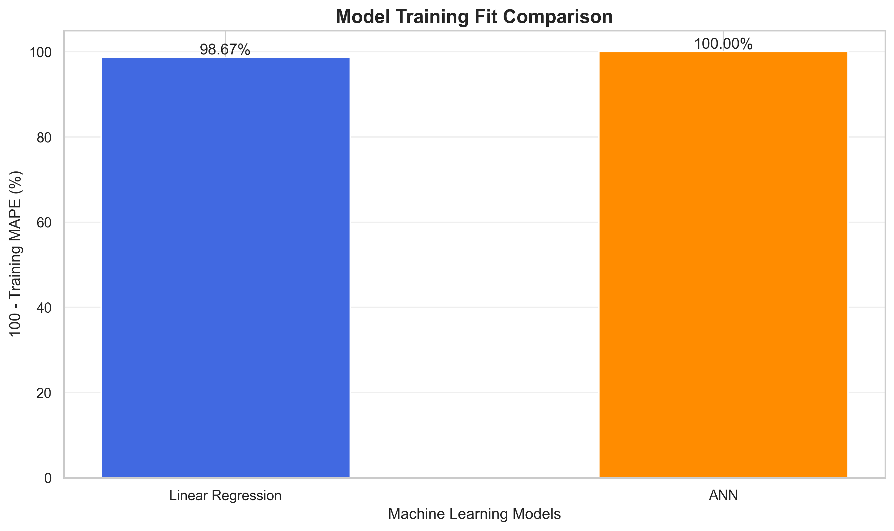
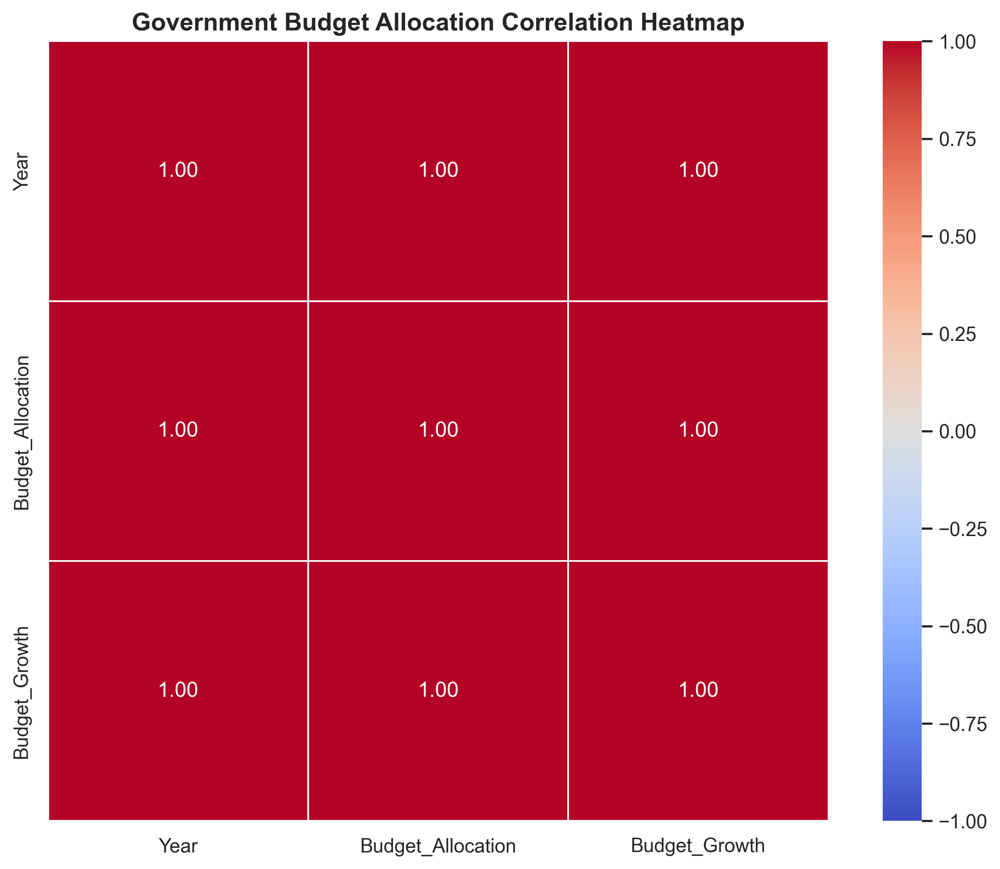
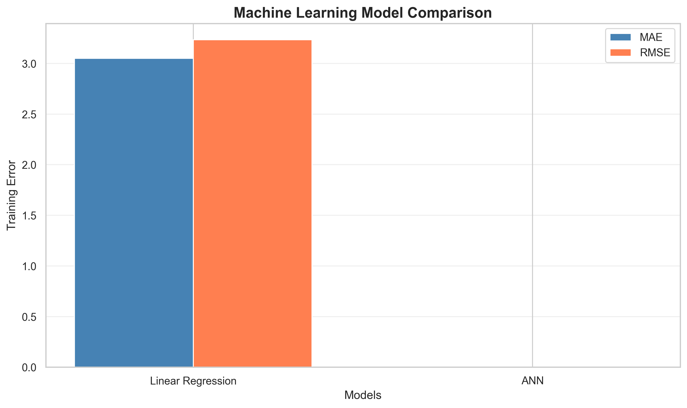
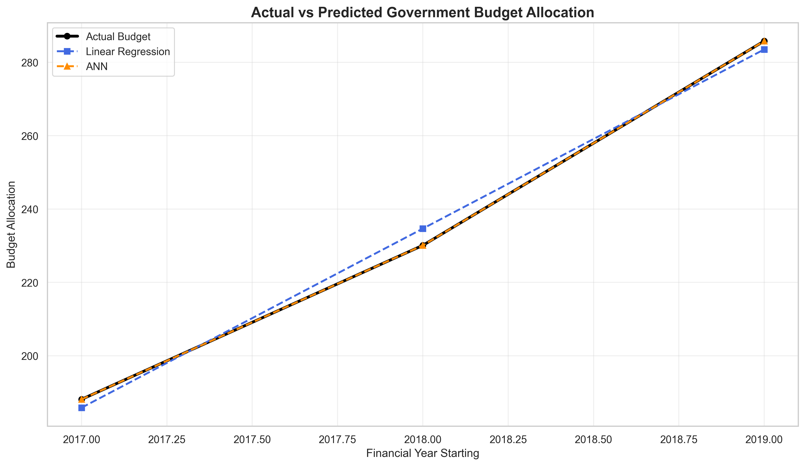
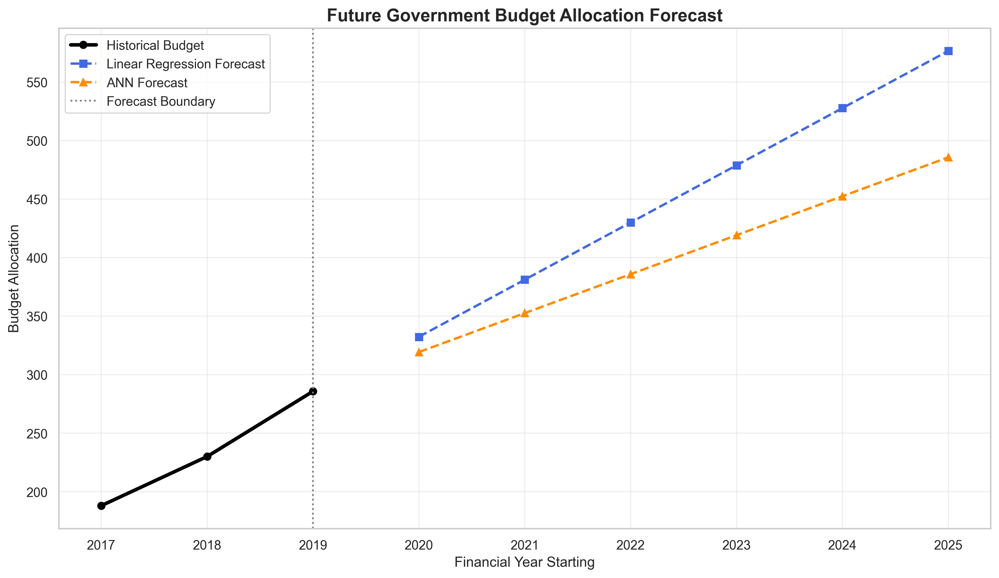
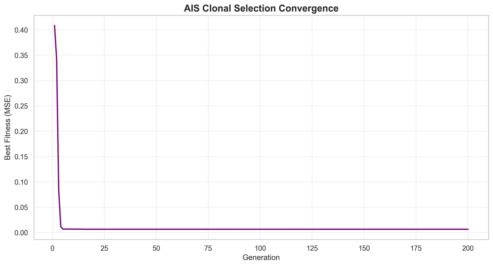
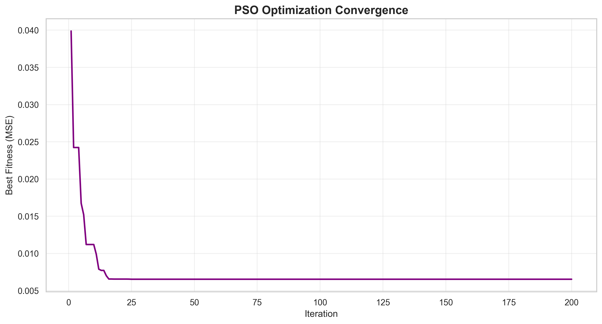

# AI-Based Government Budget Allocation Trend Analysis and Forecasting Using Machine Learning 

## 📌 Project Overview

The **AI-Based Government Budget Allocation Trend Analysis and Forecasting Using Machine Learning** project aims to analyze historical government budget allocations and forecast future financial allocations using Machine Learning and Artificial Intelligence techniques.

The project uses historical government budget allocation data to identify financial trends, analyze budget growth, and generate future allocation predictions.

Three approaches are implemented:

1. **Machine Learning (ML)** – Linear Regression and Artificial Neural Network (ANN)
2. **Artificial Immune System (AIS)** – Clonal Selection Algorithm
3. **Particle Swarm Optimization (PSO)** – Swarm Intelligence Optimization

The project also includes data preprocessing, model training, performance evaluation, statistical analysis, and visualization.

---

## 🎯 Project Objectives

- Analyze historical government budget allocation trends.
- Identify year-wise changes in budget allocation.
- Develop machine learning models for budget forecasting.
- Implement Artificial Neural Networks for regression analysis.
- Optimize prediction models using Artificial Immune System (AIS).
- Apply Particle Swarm Optimization (PSO) for parameter optimization.
- Compare the performance of ML, AIS, and PSO approaches.
- Generate future budget allocation predictions.
- Evaluate models using regression performance metrics.
- Visualize historical and predicted budget allocations.

---

## 📊 Dataset Information

**Dataset Name:** `RS_Session_252_AU_600.csv`

**Dataset Type:** Government Budget Allocation Data

**Data Format:** CSV

**Machine Learning Task:** Regression and Time-Series Forecasting

### Dataset Attributes

| Attribute | Description |
|-----------|-------------|
| Financial Year | Financial year associated with the budget allocation |
| Budget Allocation | Government budget allocation amount |
| Year | Numerical representation of the financial year |
| Budget Growth | Percentage change in budget allocation |

### Dataset Preprocessing

The following preprocessing operations are performed:

1. Load the CSV dataset using Pandas.
2. Identify financial year and budget allocation columns.
3. Handle missing values.
4. Convert financial years into numerical values.
5. Convert budget allocation values into numeric format.
6. Sort historical observations chronologically.
7. Normalize numerical features.
8. Prepare the dataset for regression model training.

**Note:** The historical dataset contains a limited number of observations. The models are intended for experimental forecasting and algorithm comparison rather than validated government budget predictions.

---

## 🛠️ Technologies Used

### Programming Language

- Python 3.10+

### Libraries and Frameworks

| Library | Purpose |
|---------|---------|
| NumPy | Numerical computations |
| Pandas | Data manipulation and preprocessing |
| Matplotlib | Data visualization |
| Seaborn | Statistical visualization |
| Scikit-learn | Machine learning and model evaluation |
| TensorFlow | Artificial Neural Network development |
| Keras | Neural network architecture and training |
| Joblib | Model serialization |
| PyYAML | YAML configuration management |
| JSON | Model metadata and result storage |
| H5py | HDF5 model file support |

### Development Environment

- Jupyter Notebook
- Visual Studio Code
- Python
- Windows

---

## 🧠 Machine Learning Algorithms

### 1. Linear Regression

Linear Regression is used to identify relationships between financial years and government budget allocations.

The prediction equation is:

\[
Y = mX + c
\]

Where:

- \(Y\) = Predicted budget allocation
- \(X\) = Financial year
- \(m\) = Regression coefficient
- \(c\) = Intercept

Linear Regression serves as the baseline forecasting model.

### 2. Artificial Neural Network (ANN)

An Artificial Neural Network is implemented to learn relationships between historical financial years and budget allocation values.

#### ANN Architecture

| Layer | Neurons | Activation |
|-------|---------|------------|
| Input | 1 | Input |
| Hidden Layer 1 | 32 | ReLU |
| Hidden Layer 2 | 16 | ReLU |
| Hidden Layer 3 | 8 | ReLU |
| Output | 1 | Linear |

#### Training Configuration

- Optimizer: Adam
- Learning Rate: 0.001
- Loss Function: Mean Squared Error
- Epochs: 300
- Batch Size: 1

The trained ANN model is saved as:

`budget_prediction_model.h5`

---

## 🧬 Artificial Immune System (AIS)

Artificial Immune System is a bio-inspired optimization technique based on the adaptive immune system.

The project implements the **Clonal Selection Algorithm (CLONALG)** to optimize regression model coefficients.

### AIS Working Process

1. Generate an initial population of antibodies.
2. Evaluate antibody fitness using Mean Squared Error.
3. Select antibodies with better fitness values.
4. Clone selected antibodies.
5. Apply hypermutation to generate new candidate solutions.
6. Replace weaker solutions with improved antibodies.
7. Repeat the process until the maximum number of generations is reached.
8. Save the best optimized regression coefficients.

### AIS Configuration

| Parameter | Value |
|-----------|-------|
| Population Size | 50 |
| Generations | 200 |
| Clone Factor | 5 |
| Mutation Rate | 0.20 |
| Optimization Objective | Minimize MSE |
| Model Type | Linear Regression |

### AIS Output Files

- `ais_model.pkl`
- `ais_model_config.yaml`
- `ais_model_metadata.json`
- `ais_accuracy_graph.png`
- `ais_heatmap.png`
- `ais_comparison_graph.png`
- `ais_result.csv`
- `ais_result_graph.png`
- `ais_prediction.csv`
- `ais_prediction_graph.png`
- `ais_convergence.csv`
- `ais_convergence_graph.png`
- `ais_evaluation_metrics.json`

---

## 🐦 Particle Swarm Optimization (PSO)

Particle Swarm Optimization is a population-based optimization algorithm inspired by the collective behavior of birds and fish.

PSO is used to optimize the regression coefficients for government budget allocation forecasting.

### PSO Working Process

1. Initialize particles with random positions and velocities.
2. Calculate the fitness of each particle.
3. Identify the personal best position of every particle.
4. Identify the global best position.
5. Update particle velocities.
6. Update particle positions.
7. Evaluate updated particle fitness.
8. Repeat until the maximum number of iterations is reached.
9. Save the best optimized model parameters.

### PSO Velocity Equation

\[
v_i^{t+1} =
wv_i^t +
c_1r_1(pbest_i-x_i^t) +
c_2r_2(gbest-x_i^t)
\]

Where:

- \(w\) = Inertia weight
- \(c_1\) = Cognitive coefficient
- \(c_2\) = Social coefficient
- \(r_1,r_2\) = Random numbers
- \(pbest\) = Personal best position
- \(gbest\) = Global best position

### PSO Configuration

| Parameter | Value |
|-----------|-------|
| Number of Particles | 50 |
| Maximum Iterations | 200 |
| Inertia Weight | 0.7 |
| Cognitive Coefficient | 1.5 |
| Social Coefficient | 1.5 |
| Optimization Objective | Minimize MSE |

### PSO Output Files

- `pso_model.pkl`
- `pso_model_config.yaml`
- `pso_model_metadata.json`
- `pso_accuracy_graph.png`
- `pso_heatmap.png`
- `pso_comparison_graph.png`
- `pso_result.csv`
- `pso_result_graph.png`
- `pso_prediction.csv`
- `pso_prediction_graph.png`
- `pso_convergence.csv`
- `pso_convergence_graph.png`
- `pso_evaluation_metrics.json`

---

## 📈 Model Performance Evaluation

The models are evaluated using regression performance metrics.

### Mean Absolute Error (MAE)

\[
MAE = \frac{1}{n}\sum_{i=1}^{n}|y_i-\hat{y}_i|
\]

MAE measures the average absolute difference between actual and predicted values.

### Mean Squared Error (MSE)

\[
MSE = \frac{1}{n}\sum_{i=1}^{n}(y_i-\hat{y}_i)^2
\]

MSE measures the average squared prediction error.

### Root Mean Squared Error (RMSE)

\[
RMSE = \sqrt{MSE}
\]

RMSE measures prediction error in the same units as the target variable.

### R-Squared Score

\[
R^2 = 1-\frac{SS_{res}}{SS_{tot}}
\]

R² measures the proportion of variation explained by the regression model.

### Mean Absolute Percentage Error (MAPE)

\[
MAPE =
\frac{100}{n}
\sum_{i=1}^{n}
\left|
\frac{y_i-\hat{y}_i}{y_i}
\right|
\]

MAPE measures percentage prediction error when actual values are nonzero.

### Percentage-Based Training Fit

The project also reports:

\[
Training\ Fit = 100-MAPE
\]

This measure is used for visualization purposes.

It is not classification accuracy and should not be interpreted as validated forecasting accuracy.

---

## 📊 Data Visualization

The project generates multiple visualizations to analyze budget allocation trends and compare model performance.

### 1. Accuracy Graph

The accuracy graph compares the percentage-based training fit of the machine learning models.



**File:** `accuracy_graph.png`

The graph provides a visual comparison of model fit based on the training dataset.

### 2. Correlation Heatmap



**File:** `heatmap.png`

The heatmap visualizes correlations among financial years, budget allocations, and derived growth measurements.

### 3. Model Comparison Graph



**File:** `comparison_graph.png`

The comparison graph displays regression errors such as MAE and RMSE.

### 4. Actual vs Predicted Results



**File:** `result_graph.png`

This graph compares historical budget allocation values with model predictions.

### 5. Future Budget Allocation Forecast



**File:** `prediction_graph.png`

The prediction graph displays historical allocations and experimental future forecasts.

### 6. AIS Optimization Convergence



**File:** `ais_convergence_graph.png`

The graph illustrates how the AIS optimization objective changes across generations.

### 7. PSO Optimization Convergence



**File:** `pso_convergence_graph.png`

The graph illustrates the improvement in PSO fitness values over successive iterations.

---

## 📂 Project Structure

```text
AI-Based Government Budget Allocation Trend Analysis
and Forecasting Using Machine Learning/
│
├── RS_Session_252_AU_600.csv
│
├── README.md
│
├── budget_prediction_model.h5
├── budget_prediction_model.pkl
├── x_scaler.pkl
├── y_scaler.pkl
│
├── model_config.yaml
├── model_metadata.json
│
├── cleaned_dataset.csv
├── future_budget_predictions.csv
├── future_budget_predictions.json
│
├── accuracy_graph.png
├── heatmap.png
├── comparison_graph.png
├── result.csv
├── result_graph.png
├── prediction.csv
├── prediction_graph.png
├── model_comparison.csv
│
├── ais_model.pkl
├── ais_model_config.yaml
├── ais_model_metadata.json
├── ais_cleaned_dataset.csv
├── ais_accuracy_graph.png
├── ais_heatmap.png
├── ais_comparison_graph.png
├── ais_model_comparison.csv
├── ais_result.csv
├── ais_result_graph.png
├── ais_prediction.csv
├── ais_prediction_graph.png
├── ais_convergence.csv
├── ais_convergence_graph.png
├── ais_evaluation_metrics.json
│
├── pso_model.pkl
├── pso_model_config.yaml
├── pso_model_metadata.json
├── pso_cleaned_dataset.csv
├── pso_accuracy_graph.png
├── pso_heatmap.png
├── pso_comparison_graph.png
├── pso_model_comparison.csv
├── pso_result.csv
├── pso_result_graph.png
├── pso_prediction.csv
├── pso_prediction_graph.png
├── pso_convergence.csv
├── pso_convergence_graph.png
└── pso_evaluation_metrics.json
```

The directory structure represents the combined outputs of the ML, AIS, and PSO implementations.

Some files are generated only when their corresponding training or visualization scripts are executed.

---

## ⚙️ Installation and Setup

### Step 1: Install Python

Install Python 3.10 or a compatible version.

### Step 2: Download the Project

Clone the repository:

```bash
git clone <your-repository-url>
```

Replace `<your-repository-url>` with your actual Git repository URL.

Alternatively, download the project as a ZIP file and extract it.

### Step 3: Navigate to the Project Directory

```bash
cd "AI-Based Government Budget Allocation Trend Analysis and Forecasting Using Machine Learning"
```

### Step 4: Install Required Libraries

```bash
pip install numpy pandas matplotlib seaborn scikit-learn tensorflow joblib pyyaml h5py
```

### Step 5: Configure the Dataset Path

Update the project directory in the Python scripts:

```python
import os

PROJECT_PATH = (
    r"C:\Users\sagni\Downloads"
    r"\AI-Based Government Budget Allocation Trend Analysis "
    r"and Forecasting Using Machine Learning"
)

DATASET_PATH = os.path.join(
    PROJECT_PATH,
    "RS_Session_252_AU_600.csv"
)
```

### Step 6: Execute the Machine Learning Model

Run the machine learning training code in Jupyter Notebook or VS Code.

The script trains the regression models and saves the corresponding model files.

### Step 7: Generate Visualizations

Execute the visualization code to generate:

- Accuracy graph
- Correlation heatmap
- Model comparison graph
- Result CSV and graph
- Prediction CSV and graph

### Step 8: Execute AIS Optimization

Run the AIS implementation.

All AIS results are saved with the `ais_` prefix.

### Step 9: Execute PSO Optimization

Run the PSO implementation.

All PSO results are saved with the `pso_` prefix.

---

## 🔄 Project Workflow

```text
                 START
                   |
                   v
             Load Dataset
                   |
                   v
            Data Cleaning
                   |
                   v
          Data Preprocessing
                   |
                   v
           Feature Selection
                   |
                   v
          Feature Normalization
                   |
                   v
          Model Implementation
                   |
          +--------+--------+
          |        |        |
          v        v        v
         ML       AIS      PSO
          |        |        |
          v        v        v
       Training  Clonal   Particle
                 Selection Swarm
          |        |        |
          +--------+--------+
                   |
                   v
           Model Evaluation
                   |
                   v
          Performance Comparison
                   |
                   v
           Future Forecasting
                   |
                   v
          Result Visualization
                   |
                   v
             Save Outputs
                   |
                   v
                  END
```

---

## 📉 Results and Analysis

The project generates three sets of experimental forecasting results.

### Traditional Machine Learning

Linear Regression provides an interpretable baseline for analyzing historical budget trends.

The Artificial Neural Network demonstrates nonlinear regression modeling.

### Artificial Immune System

AIS optimizes regression coefficients using cloning, selection, and mutation.

The convergence graph demonstrates how the optimization process searches for lower training errors.

### Particle Swarm Optimization

PSO optimizes regression coefficients through particle movement, personal best solutions, and global best solutions.

The convergence graph illustrates changes in the optimization objective across iterations.

### Model Comparison

| Approach | Method | Optimization |
|----------|--------|--------------|
| Linear Regression | Statistical Regression | Least Squares |
| ANN | Neural Network | Adam |
| AIS | Bio-Inspired Optimization | Clonal Selection |
| PSO | Swarm Intelligence | Particle Swarm Optimization |

The project generates model comparison CSV files and graphs.

Actual performance values depend on the dataset and model training results.

No fixed accuracy or error values are assumed.

---

## 🔮 Future Budget Forecasting

The system generates experimental predictions for six financial years following the latest historical observation.

For example, if the final historical year is 2019–20, predictions are generated for:

- 2020–21
- 2021–22
- 2022–23
- 2023–24
- 2024–25
- 2025–26

The prediction outputs are saved in:

```text
prediction.csv
ais_prediction.csv
pso_prediction.csv
```

These files contain model-generated budget allocation estimates.

**Important:** Forecasts generated from a very small historical dataset are illustrative and should not be used for real financial planning or government policy decisions.

---

## 📁 Model Serialization

The project saves trained models and configurations using multiple file formats.

### H5 Format

```text
budget_prediction_model.h5
```

Stores the trained Artificial Neural Network.

### PKL Format

```text
budget_prediction_model.pkl
ais_model.pkl
pso_model.pkl
```

Stores trained regression models or optimized model parameters.

### YAML Format

```text
model_config.yaml
ais_model_config.yaml
pso_model_config.yaml
```

Stores model configuration and optimization parameters.

### JSON Format

```text
model_metadata.json
ais_model_metadata.json
pso_model_metadata.json
```

Stores model metadata, evaluation information, and experiment details.

---

## ⚠️ Project Limitations

The project has several important limitations.

1. The historical dataset contains very few observations.
2. The available data is insufficient for reliable long-term forecasting.
3. Complex neural networks may overfit the historical data.
4. Training performance does not represent independent test performance.
5. AIS and PSO optimize regression coefficients but cannot create additional historical information.
6. Future government allocations depend on economic, political, and administrative factors not represented in the dataset.
7. Forecast uncertainty increases when predicting years far beyond the historical period.

A larger historical dataset and chronological validation would be necessary before making reliable forecasting claims.

---

## 🚀 Future Enhancements

Possible improvements include:

- Collecting additional historical government budget data.
- Incorporating economic indicators such as GDP and inflation.
- Implementing time-series forecasting models.
- Exploring ARIMA and SARIMA.
- Implementing LSTM-based forecasting.
- Using chronological train-test evaluation.
- Applying walk-forward validation.
- Adding prediction intervals.
- Building an interactive Streamlit dashboard.
- Creating automated financial trend reports.
- Comparing additional optimization algorithms.
- Implementing explainable AI techniques.

---

## 🌍 Applications

Potential applications of the project include:

- Government budget trend analysis
- Public finance research
- Financial data visualization
- Academic machine learning demonstrations
- Budget allocation pattern identification
- Comparative optimization algorithm research
- Experimental financial forecasting

---

## 📚 Key Concepts

This project demonstrates:

- Machine Learning
- Regression Analysis
- Artificial Neural Networks
- Artificial Immune Systems
- Clonal Selection Algorithms
- Particle Swarm Optimization
- Feature Scaling
- Data Preprocessing
- Model Evaluation
- Time-Series Trend Analysis
- Data Visualization
- Model Serialization

---

## 📝 Conclusion

The **AI-Based Government Budget Allocation Trend Analysis and Forecasting Using Machine Learning** project demonstrates how traditional machine learning and bio-inspired optimization techniques can be applied to historical government budget data.

Linear Regression provides a baseline forecasting approach, while Artificial Neural Networks introduce neural network-based regression modeling.

Artificial Immune System and Particle Swarm Optimization provide alternative methods for optimizing regression coefficients.

The project generates visualizations, model evaluation reports, historical result comparisons, and experimental future budget predictions.

Although the limited dataset prevents reliable forecasting validation, the implementation provides a foundation for exploring machine learning, optimization techniques, and financial trend analysis.

With additional historical data, improved feature engineering, and appropriate validation, the project can be extended into a more robust government budget forecasting system.

---

## 📄 License

This project is intended for educational, academic, and research purposes.

---

## ⭐ Project Highlights

- Machine Learning-based budget forecasting
- Artificial Neural Network implementation
- Artificial Immune System optimization
- Particle Swarm Optimization
- Automated model evaluation
- Accuracy and error visualization
- Correlation heatmap generation
- Historical and predicted result comparison
- Future budget allocation forecasting
- CSV result generation
- Model serialization in H5 and PKL formats
- YAML configuration management
- JSON metadata storage
- High-resolution visualization outputs

---

**Project Title:** AI-Based Government Budget Allocation Trend Analysis and Forecasting Using Machine Learning

**Project Category:** Artificial Intelligence / Machine Learning / Financial Analytics

**Programming Language:** Python

**Algorithms:** Linear Regression, ANN, AIS, PSO

**Dataset:** RS_Session_252_AU_600.csv

**Main Visualization:** `accuracy_graph.png`
